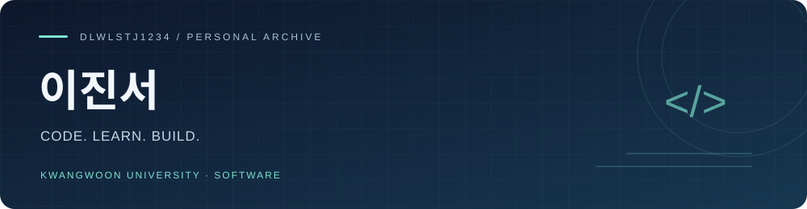
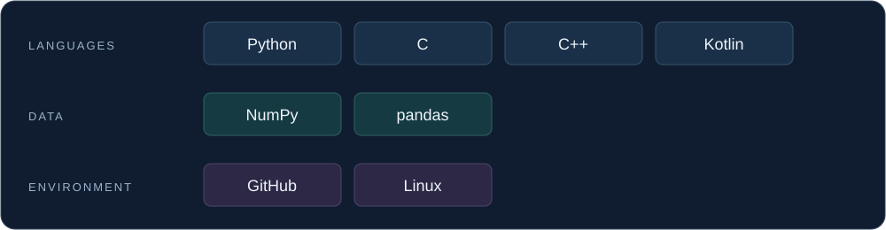

**광운대학교 소프트웨어학부 2학년**

활동과 프로젝트, 배움의 과정을 기록합니다.

[소개](#about) · [연도별 활동](#activities) · [프로젝트](#projects) · [기술 스택](#stack) · [링크](#links)

---

## 01 · 내 소개

안녕하세요. 광운대학교 소프트웨어학부 2학년에 재학 중인 **이진서**입니다.

자료구조 스터디와 해커톤, 팀 프로젝트에 참여하며 소프트웨어 개발 경험을 쌓고 있습니다.

## 02 · 연도별 활동

| 연도 | 활동 | 내용 |
| :---: | :--- | :--- |
| **2023** | Dean's List | `2학기 선정` |
| **2025** | SQLD | `자격 취득` |
| **2025** | [C++ Data Structure Study](https://github.com/HyeoniGit/cpp-Data-Structure-Study) | C++ 객체지향·템플릿 학습 및 스택·큐·연결 리스트·트리 구현 실습 |
| **2026** | KW 해커톤 | `9위` |

C++ Data Structure Study · 학습 내용

- **C++ 기초와 객체지향** · 참조자, 클래스, 생성자·소멸자, 복사 생성자, 상속과 다형성
- **언어 심화** · 연산자 오버로딩, Rule of Three, 템플릿, 예외 처리
- **선형 자료구조** · 배열 기반 스택, 원형 큐, 단일 연결 리스트 구현 실습
- **트리** · 전위·중위·후위 순회와 이진 탐색 트리의 삽입·탐색·삭제 학습

[주차별 학습 기록과 코드 →](https://github.com/HyeoniGit/cpp-Data-Structure-Study)

## 03 · 프로젝트

### 롤문철

`TEAM PROJECT` `BACKEND` `PYTHON`

**AI 분석과 커뮤니티 의견을 함께 살펴보는 리그오브레전드 플레이 분석 웹 서비스**

플레이 영상 링크와 챔피언 정보를 바탕으로 AI가 상황을 분석하고, 사용자가 투표와 댓글로 의견을 나누는 팀 프로젝트입니다.

| 구분 | 내용 |
| :--- | :--- |
| 담당 | **백엔드** |
| 담당 범위 | 개발 환경 및 기본 서버 구축, 영상 업로드 처리, 댓글·투표 시스템, 정렬 시스템 |
| 백엔드 기술 | Python |
| 프로젝트 연동 | Gemini API 기반 영상 분석 · Riot API 기반 소환사 인증 |

[저장소 보기 →](https://github.com/dlwlstj1234/Team_rm-rf)

<!-- 담당 범위는 저장소 README의 이진서 역할 분담 기준입니다. 기간과 진행 상태는 확인 후 추가합니다. -->

---

### 월계 알리미

`KW HACKATHON 2026` `BACKEND` `DATA PIPELINE`

**지역 공지를 모아 요약과 쉬운말로 전달하는 2026 KW 해커톤 팀 프로젝트**

노원구·월계1동·서울시의 공지를 수집하고, AI 요약과 쉬운말 설명을 모바일 앱에서 제공하는 서비스입니다.

| 구분 | 내용 |
| :--- | :--- |
| 담당 | **백엔드 · 공지 수집 및 AI 입력 준비 파이프라인** |
| 주요 기능 | 공지 조회, 4카드 요약, 쉬운말·용어 설명, 공지 저장, 알림·Android 위젯 |
| 개인 작업 기술 | Python · uv · PostgreSQL · GitHub Actions |
| 프로젝트 기술 | Expo · React Native · TypeScript · Supabase · Gemini API |

내 기여와 문제 해결

- **공지 수집·저장** · 노원구 API, 월계1동 게시판, 서울시 API에서 공지와 파일 정보를 수집하고 DB에 저장하는 파이프라인 구현
- **데이터 일관성** · 재수집 시 중복 방지, 본문·파일 변경 감지, 공지와 파일의 트랜잭션 저장 및 실패 시 롤백 처리
- **파일 주소 복구** · 노원구 API에서 가려진 파일 주소를 원문과 대조해 복구하고, 확인할 수 없는 경우 기존 데이터 보존
- **AI 입력 준비** · 공지 본문을 평문으로 변환하고 PDF·이미지·HWP를 요약 모듈이 사용할 입력으로 구성
- **실패 처리와 검증** · 다운로드 주소·용량·형식 검사, 중복 입력 제거, 실패 격리와 자동 테스트 작성

기여 기록: [수집 파이프라인](https://github.com/2026-KW-HACKATHON/02_Cotton-Candy-and-Raccoon/pull/10) · [서울시 수집·저장 연동](https://github.com/2026-KW-HACKATHON/02_Cotton-Candy-and-Raccoon/pull/19) · [파일 주소 복구](https://github.com/2026-KW-HACKATHON/02_Cotton-Candy-and-Raccoon/pull/23) · [AI 입력 준비](https://github.com/2026-KW-HACKATHON/02_Cotton-Candy-and-Raccoon/pull/29)

[저장소 보기 →](https://github.com/2026-KW-HACKATHON/02_Cotton-Candy-and-Raccoon)

---

### 마이링크 · my-link

`WEB APPLICATION` `NEXT.JS` `FIREBASE`

**프로필과 여러 링크를 하나의 페이지로 공유하는 웹 서비스**

Google 계정으로 로그인해 프로필과 링크를 관리하고, 닉네임 기반 공개 페이지로 공유할 수 있는 프로젝트입니다.

| 구분 | 내용 |
| :--- | :--- |
| 프로필 | 표시 이름·소개 수정, 이름 중복 확인, 비로그인 공개 페이지 |
| 링크 관리 | 사용자별 링크 추가·수정·삭제 |
| 통계 | 링크 클릭수 집계와 통계 차트 |
| 공유 | 프로필별 검색 메타데이터와 공유 이미지 |
| 프로젝트 기술 | Next.js · React · TypeScript · Tailwind CSS · Firebase · TanStack Query |

주요 개발 내용

- **사용자별 데이터 관리** · Firebase Authentication과 Firestore를 이용한 로그인 및 사용자별 프로필·링크 관리
- **표시 이름 예약** · Firestore 트랜잭션으로 중복 이름을 방지하고 이름 변경과 예약 해제를 함께 처리
- **조회 상태 관리** · 사용자별 쿼리 키를 사용하고 로그아웃·계정 전환 시 이전 캐시 정리
- **공개 프로필과 공유** · 닉네임 기반 페이지, canonical 주소, 프로필별 Open Graph 이미지 구성
- **클릭 통계** · 링크별 누적 클릭수 저장과 로그인 사용자 전용 통계 화면 제공

[저장소 보기 →](https://github.com/dlwlstj1234/my-link)

## 04 · 기술 스택

## 05 · 링크

<!-- 추후 추가 예정. -->

